# Domain model — <intent id>

## Bounded contexts touched

| Context | Service | Change |
|---|---|---|
| | | new / changed / unchanged |

## Aggregates

| Aggregate | Entities / value objects | Invariants (BR-n) |
|---|---|---|
| | | |

## State machines

```mermaid
stateDiagram-v2
  [*] --> <State1>
  <State1> --> <State2>: <command> [guard]
```

| From | To | Command | Guard / rule | Who may |
|---|---|---|---|---|

## Domain events

| Event | Version | Raised when | Published externally? |
|---|---|---|---|

## Ubiquitous language

| Term | Meaning |
|---|---|
