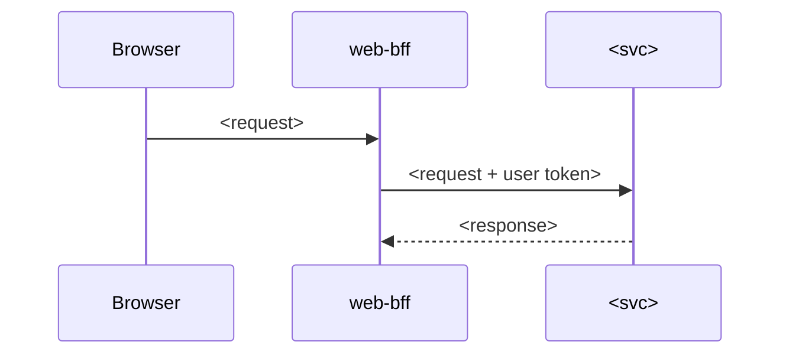

# Logical design — <intent id>

## Services and responsibilities

| Service | Responsibility in this intent | New / changed interfaces |
|---|---|---|

## APIs (draft)

| Method | Path | Purpose | Auth | Errors |
|---|---|---|---|---|

Draft OpenAPI fragments: <link or inline>

## Events (draft)

| Event | Producer | Consumers | Schema draft |
|---|---|---|---|

## Database objects

| Service DB | Tables (V__) | Routines (R__) | Indexes |
|---|---|---|---|

## Sequence diagrams

## Cross-service consistency (ARCH-08)

| Use case | Services | Expected delay | Failure handling |
|---|---|---|---|

## Decisions needing ADRs

- <…>
