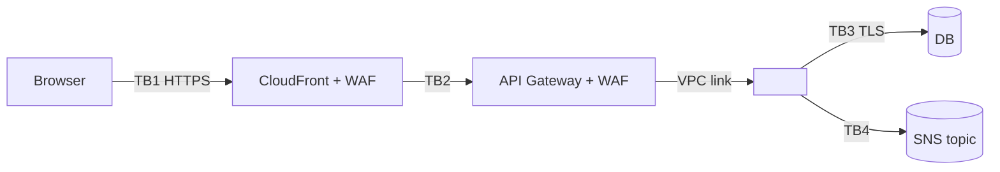

# Threat model — <scope>

- **Version / date:** <n> / <YYYY-MM-DD>
- **Inputs:** <stories>, <data-classification.md>, <logical-design.md>
- **Reviewer:** `security-reviewer` + <human>

## Data-flow diagram

## Trust boundaries

| ID | Boundary | Crossing flows |
|---|---|---|
| TB1 | Internet ↔ edge | <…> |

## Threats (STRIDE)

| ID | STRIDE | Element / flow | Threat | Asset | Risk (H/M/L) | Mitigation (rule IDs / ADRs) | Test / evidence | Residual |
|---|---|---|---|---|---|---|---|---|
| T1 | S | <…> | <…> | <…> | | | | |

## Residual risks for acceptance

| Threat | Residual | Proposed owner | Accepted by / date |
|---|---|---|---|
| | | | pending |

## Changes since previous version

- <…>
